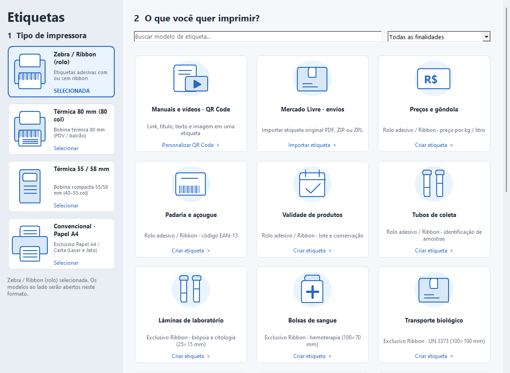
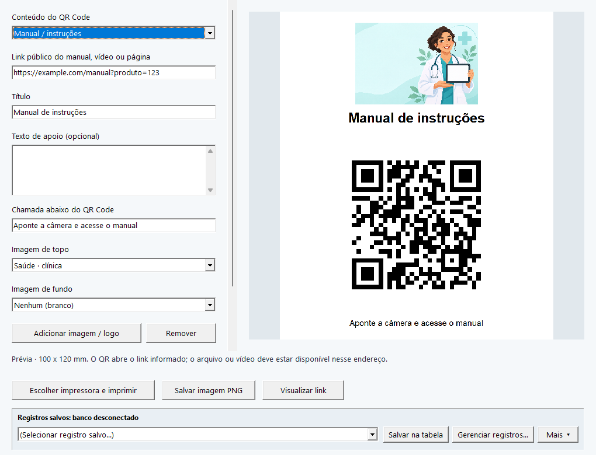
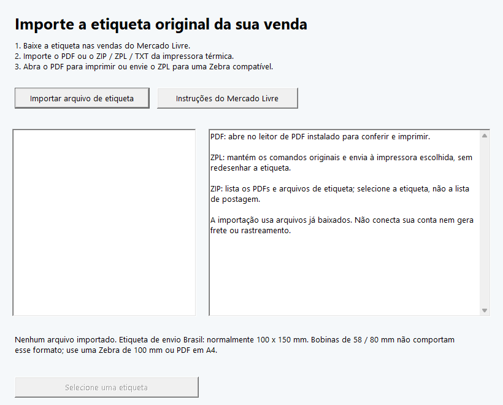
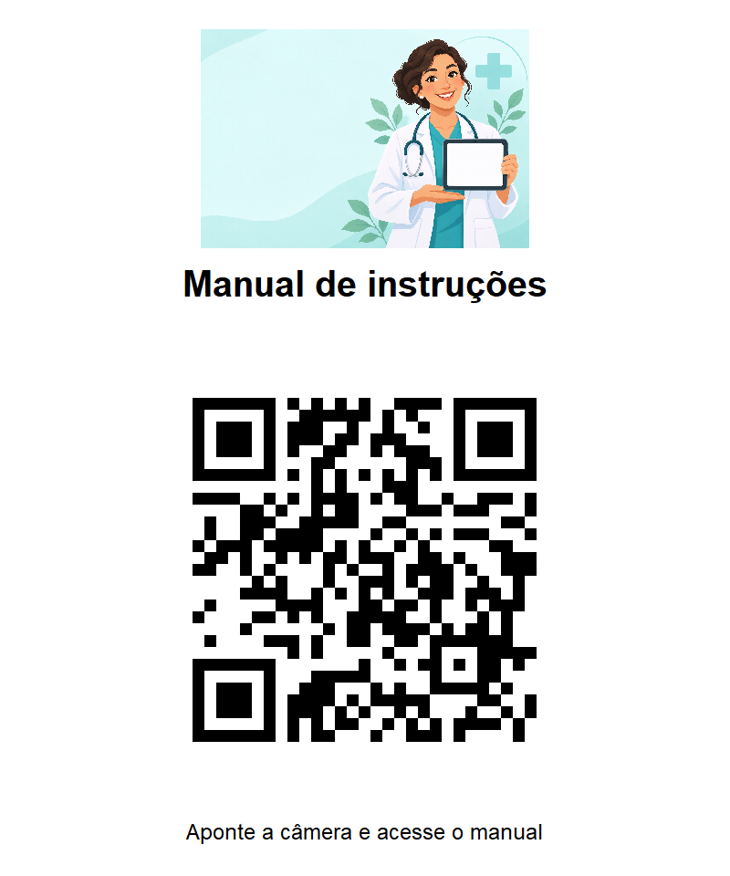
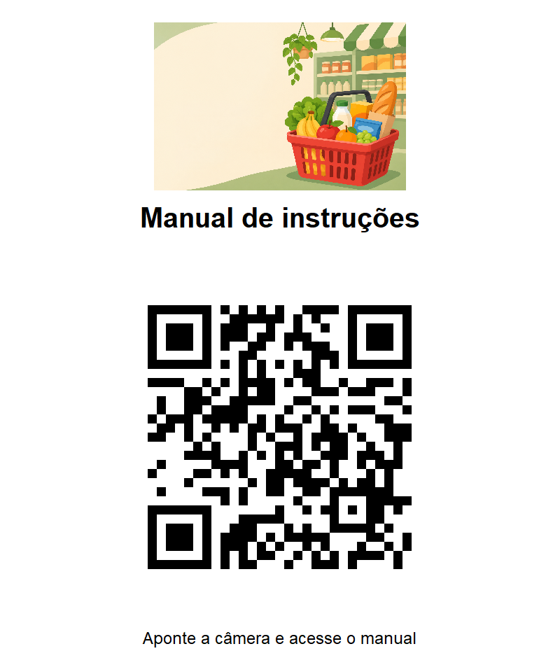

# Etiquetas

**Etiquetas** é um sistema desktop para gerenciamento e impressão de etiquetas, desenvolvido em **Lazarus / Free Pascal**, com banco de dados **SQLite** e foco em operação simples para pequenos negócios, comércios, laboratórios, almoxarifados e rotinas administrativas que precisam emitir etiquetas com rapidez.

O projeto nasceu para facilitar a criação, seleção, importação e impressão de etiquetas em impressoras compatíveis com o ambiente do sistema operacional, com destaque para uso com **impressoras Zebra**, etiquetas de gôndola, etiquetas de laboratório, mala direta e QR Code PIX.

## Novidades da interface

O início usa cartões ilustrados para escolher **Zebra/rolo**, **térmica de 80 mm**,
**térmica de 58 mm** ou **laser/jato de tinta**. A busca e o filtro por finalidade
ajudam a encontrar os modelos; a grade se reorganiza ao redimensionar a janela.

- **Manuais e vídeos · QR Code:** link, título, texto de apoio, imagem/logotipo,
  quatro fundos de saúde e varejo, prévia, exportação PNG e impressão.
- **Mercado Livre · envios:** importação de etiquetas originais PDF, ZIP, ZPL,
  TXT e PRN. PDF abre no leitor instalado; ZPL pode ser enviado diretamente a
  uma Zebra compatível no Windows.
- **Tela clássica:** continua disponível em **Configurações → Alternar início /
  tela clássica**, mantendo os fluxos de produtos, laboratório, mala direta e PIX.

Veja o [guia do início visual](doc/NOVO_INICIO.md) e o
[manual do usuário](doc/manual_usuario.md). A seleção do tipo de impressora
define o modelo, mas o dispositivo e o papel ainda devem ser conferidos na
janela de impressão. Etiquetas de envio de 100 × 150 mm não cabem em bobinas
de 58/80 mm.

---

## Visão comercial

O Etiquetas busca resolver um problema comum em operações comerciais e administrativas: transformar dados simples de produtos, endereços ou identificações em etiquetas prontas para impressão, sem depender de planilhas manuais ou sistemas grandes demais para tarefas pequenas.

Com ele, o usuário pode manter uma base local de produtos e endereços, importar dados por CSV, selecionar registros para impressão e gerar etiquetas em fluxos separados conforme o tipo de uso.

---

## Principais recursos

- Cadastro e gerenciamento local de produtos.
- Impressão de etiquetas de gôndola / preço.
- Seleção de produtos para fila de impressão.
- Importação de produtos via CSV.
- Importação de endereços via CSV para mala direta.
- Importação de etiquetas de laboratório via CSV.
- Impressão de etiquetas de mala direta com remetente e destinatário.
- Impressão de etiquetas de laboratório com código de barras.
- Geração e impressão de QR Code PIX a partir de uma string informada.
- QR Codes para manuais, vídeos e páginas, com textos, imagens e fundos ilustrados.
- Importação de etiquetas de envio do Mercado Livre, preservando o arquivo original.
- Configuração de banco SQLite e biblioteca `sqlite3.dll`.
- Configuração dos dados da empresa usados em etiquetas de mala direta.
- Integração com impressão padrão do sistema operacional.

---

## Módulos do sistema (Separados por Tipo de Impressora)

O sistema organiza a emissão de etiquetas em **4 categorias de impressoras**, atendendo **Supermercados/Varejo**, **Hospitais/Saúde**, **Laboratórios/Farmácias**, **Envio/Despacho** e **Crachás**:

| Impressora Alvo | Modelos e Aplicações Disponíveis |
|---|---|
| **1. Impressora Tipo Zebra (Rolo)** | • **Supermercado/Varejo:** Gôndola com Preço + Preço por Kg/Litro (`100×35mm`), Balança Padaria/Açougue com cálculo automático de EAN-13 prefixo `2` (`60×40mm`), Validade ANVISA RDC 216 (`50×30mm`). • **Laboratório:** Exame/Tubo de Coleta (`51×25mm`), Lâmina de Biópsia/Patologia (`25×15mm`), Bolsa de Sangue/Hemoterapia (`100×70mm`), Transporte Biológico UN 3373 (`100×100mm`). • **Hospital & Farmácia:** Pulseira Neonatal (`25×285mm`), Medicamento Avulso/Posologia (`60×40mm`), Dose Unitária/Fracionamento (`40×30mm`), Rótulo de Soro/Infusão EV (`80×50mm`). • **Despacho & Crachás:** Despacho Multi-Volumes (`100×150mm`), Crachá Visitante/Acompanhante (`80×50mm`), Crachá Funcionário c/ Foto P&B (`54×86mm`). |
| **2. Térmica 80 Colunas (Bobina 80mm PDV)** | Impressão via driver Windows ou envio direto `TAIPOSPrinter` (ESC/POS Serial/Ethernet) para Gôndola/Promoção 80mm, Comanda/Balança Padaria, Validade ANVISA, Posologia/Receituário Avulso, Dose Unitária, Rótulo de Soro, Despacho Contínuo e Crachás de Portaria. |
| **3. Térmica 40 Colunas / 58mm (Maquininha)** | Impressão compacta (`pmQR203` 32/40 colunas) para coletores móveis, mini-impressoras portáteis e maquininhas: Preço Rápido de Corredor, Validade ANVISA, Dose Unitária Beira-Leito, Coleta Domiciliar, Etiqueta de Sacola/Delivery e Passe Rápido de Visitante. |
| **4. Laser / Jato de Tinta (Folhas Pimaco A4 / Carta)** | Suporte nativo à grade de folhas **Pimaco A4248 (96/folha), A4251 (65/folha), A4255 (27/folha), A4260 (21/folha), A4262 (14/folha), A4263 (10/folha - Crachás), A4268 (4/folha - Despacho), Carta 6180 (30/folha), Carta 6182 (14/folha)** e **Cartaz de Oferta A4**, com escolha de **Linha e Coluna inicial** para reaproveitamento de folhas parcialmente usadas e integração com filtros de imagem (`imagefilters`) do pacote **TCHATGPT**. |

---

## Documentação

A documentação principal está na pasta [`doc`](doc/README.md):

- [Guia de instalação](doc/instalacao.md)
- [Manual do usuário](doc/manual_usuario.md)
- [Início visual, QR Code e Mercado Livre](doc/NOVO_INICIO.md)
- [Configuração de impressora](doc/configuracao_impressora.md)
- [Importação de CSV](doc/importacao_csv.md)
- [Documentação técnica](doc/documentacao_tecnica.md)
- [Solução de problemas](doc/solucao_de_problemas.md)

---

## Requisitos básicos

### Para usuário final

- Windows ou Linux com ambiente gráfico.
- Impressora instalada no sistema operacional.
- Banco SQLite `etiqueta.db` disponível na pasta esperada ou configurado pelo sistema.
- Biblioteca SQLite configurada corretamente, especialmente no Windows com `sqlite3.dll`.

### Para desenvolvedor

- Lazarus / Free Pascal.
- ZeosLib.
- Fortes Report para Lazarus.
- Bibliotecas utilizadas pelo projeto, como Rx, lNet visual e componente de código de barras.

---

## Estrutura do repositório

| Pasta | Descrição |
|---|---|
| `src/` | Código-fonte Lazarus / Pascal do sistema. |
| `db/` | Banco de dados base do sistema. |
| `sqlite/` | Bibliotecas SQLite utilizadas pela aplicação. |
| `csv/` | Modelos ou arquivos de importação CSV. |
| `img/` | Imagens, ícones e capturas de tela. |
| `background/qrcode/` | Fundos ilustrados de saúde e varejo usados no editor de QR Code. |
| `tests/` | Verificação do painel, importação e leitura dos QR Codes. |
| `install/win/` | Arquivos relacionados à instalação no Windows. |
| `tools/SQLiteStudio/` | Ferramenta auxiliar para inspeção/manutenção do SQLite. |
| `doc/` | Documentação de instalação, uso e suporte. |

---

## Fluxo básico de uso

1. Instale ou copie o sistema para uma pasta local.
2. Abra o sistema Etiquetas.
3. Acesse **Configurações → Preferências** e confira o caminho do banco SQLite e da biblioteca SQLite.
4. Configure os dados da empresa, quando for usar mala direta.
5. Escolha o tipo de impressora no painel inicial.
6. Busque o modelo e abra seu cartão. Para bases existentes, use **Configurações → Importar dados** e os fluxos da tela clássica.
7. Preencha o conteúdo, informe o link do QR Code ou importe a etiqueta de envio, conforme o modelo escolhido.
8. Confira a prévia, escolha a impressora e verifique papel, dimensões e escala antes de imprimir.

---

## Status do projeto

O projeto está funcional como aplicação desktop de etiquetas, com módulos específicos já implementados. Alguns pontos ainda podem evoluir para fortalecer a apresentação comercial, como empacotamento de releases, instalador padronizado, validações mais amigáveis, manual com imagens e revisão de mensagens internas para português.

---

## Screenshots

Editor de QR Code para manuais, vídeos e orientações, com fundo de saúde:

Importação de etiquetas de envio:

Exemplos de etiquetas com os novos fundos:

| Saúde | Varejo |
|---|---|
|  |  |

As capturas usam dados demonstrativos. Veja o [registro das imagens](img/screens/README.md).

---

## Autor

Desenvolvido por **Marcelo Maurin Martins**.

GitHub: [marcelomaurin](https://github.com/marcelomaurin)

---

## Licença

Consulte os arquivos do repositório para informações de licença. Caso o projeto seja distribuído comercialmente, recomenda-se incluir um arquivo `LICENSE` formal.
