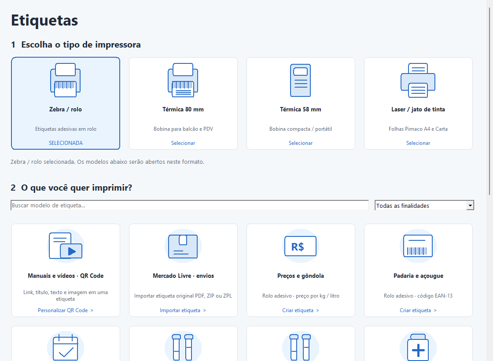
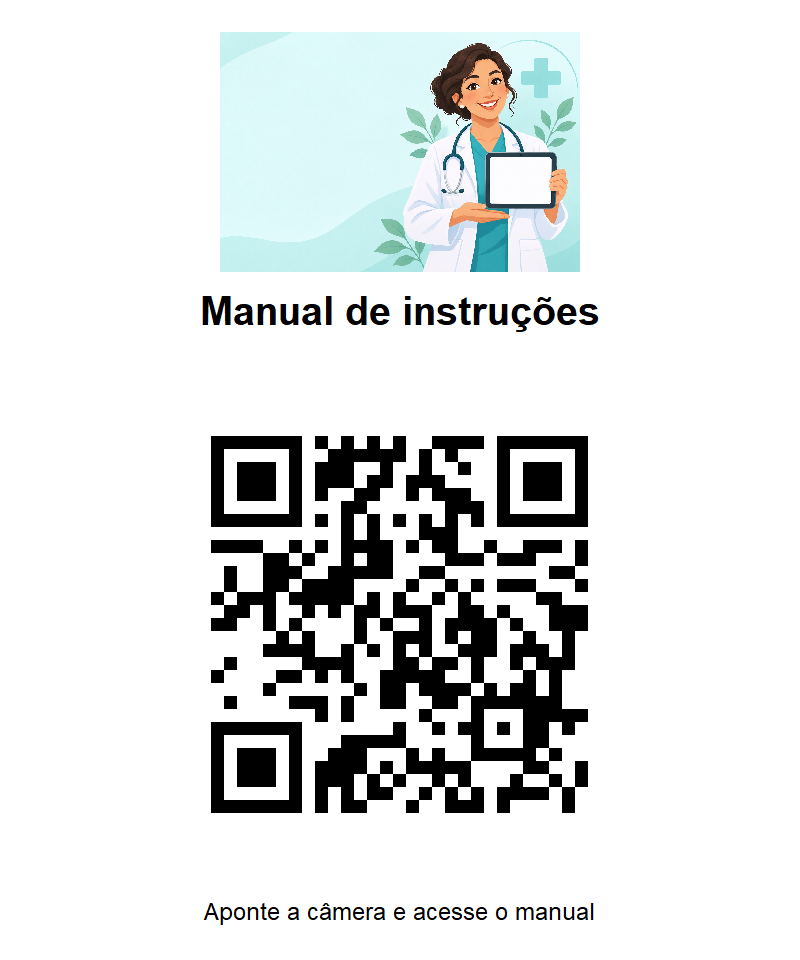
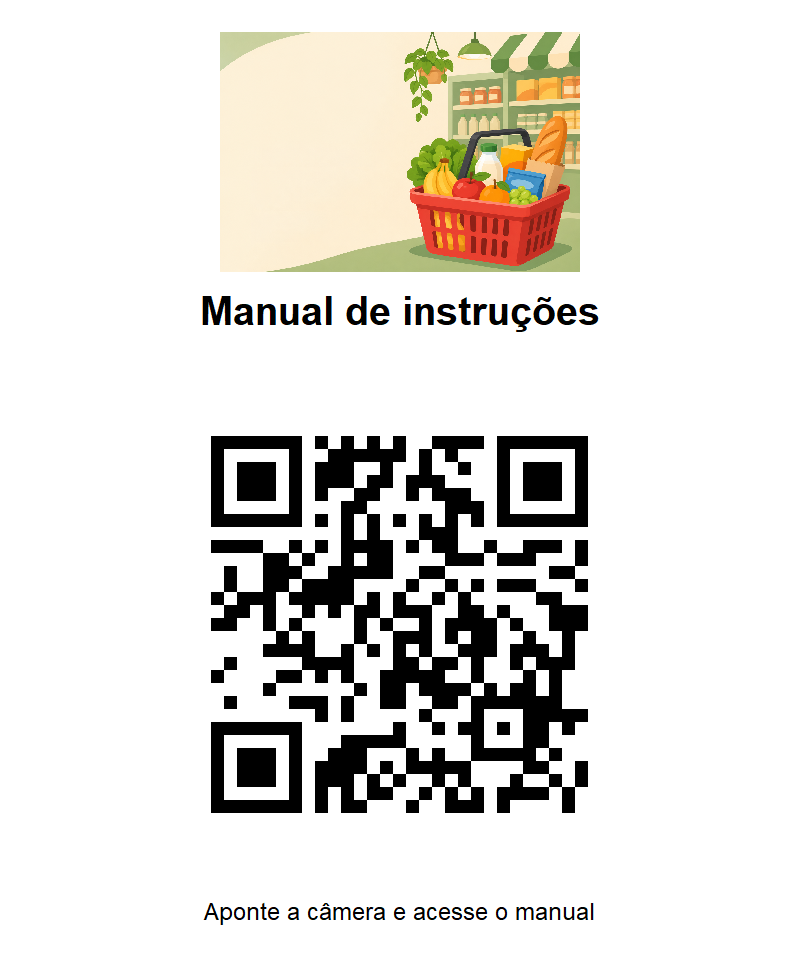

# Início visual e novos modelos

Escolha primeiro o tipo de impressora nos quatro cartões ilustrados. O catálogo
abre cada modelo no modo escolhido: Zebra/rolo, térmica de 80 mm, térmica de
58 mm ou laser/jato com folhas Pimaco. A busca e o filtro por finalidade ajudam
a encontrar o modelo. A grade reorganiza os cartões quando a janela muda de tamanho.

As funções anteriores continuam disponíveis nos menus e em **Configurações →
Alternar início / tela clássica**.

## Manuais, vídeos e orientações em QR Code

1. Abra **Manuais e vídeos · QR Code**.
2. Escolha manual, vídeo, saúde ou divulgação.
3. Informe o link público completo (`https://...`) para o arquivo, vídeo ou página.
4. Personalize título, texto de apoio e chamada. Escolha um fundo ilustrado e,
   se quiser, adicione uma imagem ou logotipo sobre a área livre da ilustração.
5. Confira a prévia, as dimensões e o link. Salve em PNG ou abra a seleção de
   impressora para imprimir.

O QR contém o link; o aplicativo não hospeda o manual ou o vídeo. O arquivo
deve estar acessível ao público que irá escanear. As imagens ficam separadas do
QR. O símbolo usa módulos inteiros, margem branca de quatro módulos e validação
de densidade para o tamanho selecionado.

As térmicas usam larguras úteis de até 72 mm (bobina 80 mm) e 48 mm (bobina
58 mm); confirme a área imprimível do seu modelo. Zebra permite até 104 mm.
No modo laser/jato também há **Cartaz A4** (190 × 277 mm de área útil).
O cartão QR em folha é uma impressão individual, sem grade Pimaco. Para os
outros modelos de etiqueta, o catálogo Pimaco mantém suas grades originais.

O editor não altera automaticamente o papel do driver. Selecione o papel
correspondente nas propriedades da impressora. Formatos maiores que a área
imprimível são bloqueados. Textos que não cabem e links densos demais também
bloqueiam a impressão até a correção.

## Fundos incluídos

| Saúde | Varejo |
|---|---|
|  |  |
|  |  |

- `background/qrcode/saude-clinica.png`
- `background/qrcode/saude-laboratorio.png`
- `background/qrcode/varejo-mercado.png`
- `background/qrcode/varejo-loja.png`

Os arquivos são distribuídos junto ao aplicativo pelo instalador Windows.
São artes originais geradas com a ferramenta de imagens integrada. As
descrições usadas estão no [registro de criação dos fundos](../background/qrcode/PROMPTS.md).

Exemplos de composição, com QR válido apontando para um endereço demonstrativo:

| Clínica | Supermercado |
|---|---|
|  |  |

## Etiquetas de envio do Mercado Livre

1. No painel de vendas do Mercado Livre, obtenha a etiqueta da venda pronta
   para envio, usando a opção de impressão/baixar arquivos disponível na venda.
2. Para impressora comum, baixe o PDF. Para Zebra compatível com ZPL, baixe o
   arquivo térmico: pode ser ZPL/TXT ou um ZIP que também contenha um PDF de
   resumo/PLP.
3. No aplicativo, abra **Mercado Livre · envios → Importar arquivo de etiqueta**.
4. Se for ZIP, escolha o arquivo correto na lista. O resumo/PLP não substitui
   a etiqueta de envio.
5. PDF: use **Abrir PDF para conferir e imprimir**, selecione a impressora no
   leitor instalado e mantenha a escala original e o papel do documento.
6. ZPL: no modo Zebra, use **Enviar ZPL à impressora Zebra** e escolha uma
   impressora que entenda a linguagem ZPL. O envio direto usa a fila RAW do
   Windows, preservando os bytes originais. Não converte ZPL em imagem.

O formato brasileiro padrão é 100 × 150 mm; bobinas de 58/80 mm não comportam
esse tamanho. Não reduza a etiqueta para essas bobinas. Use Zebra de largura
adequada ou o PDF com o papel correspondente. O PDF é aberto externamente;
não há visualizador PDF ou renderizador ZPL integrado nesta versão.

A importação aceita PDF, ZIP, ZPL, TXT e PRN, verifica assinatura PDF/comandos
ZPL e limita cada arquivo a 32 MB. ZIPs são lidos em memória, sem extrair os
caminhos internos no disco. O conteúdo da etiqueta não é redesenhado ou
editado. Não é necessário informar senha ou token: esta opção importa arquivos
já baixados, sem integração automática com a conta ou emissão de frete.

Fontes oficiais consultadas em 14/11/2026:

- [Mercado Envios 2 — formatos PDF/ZPL, dimensões e disponibilidade das etiquetas](https://developers.mercadolivre.com.br/pt_br/registre-o-seu-aplicativo/mercado-envios-2)
- [Mercado Envios 2 — ZIP com TXT e PDF de resumo](https://developers.mercadolivre.com.br/en_us/mercadoenvios-mode-2)
- [Como imprimir as etiquetas de envios](https://vendedores.mercadolivre.com.br/aprender/nota/como-imprimir-as-etiquetas-de-envios?guideKeyId=GE80)
- [Etiqueta e DANFE simplificado — conservar o tamanho e códigos visíveis](https://vendedores.mercadolivre.com.br/nota/como-imprimir-o-danfe-simplificado-junto-com-a-etiqueta-de-envio)

## Verificação

Compile o aplicativo e o projeto `tests/testar_inicio.lpi` com o Lazarus.
Execute `tests/testar_inicio.exe`: os resultados e capturas ficam em
`tests/output`. Com OpenCV disponível, execute `python tests/verificar_qr.py`
para decodificar os QR Codes de todos os tipos de impressora e dos quatro
fundos. Os testes também verificam filtros, links inválidos, reconhecimento
dos arquivos de envio, leitura de ZIP em memória e preservação dos bytes ZPL.

A validação não envia trabalhos à impressora física nem acessa uma conta do
Mercado Livre.
