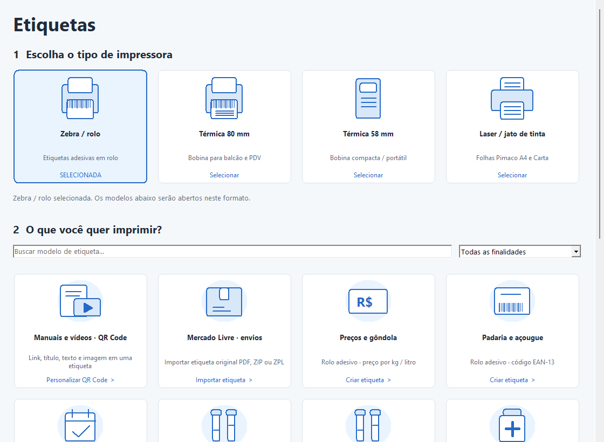
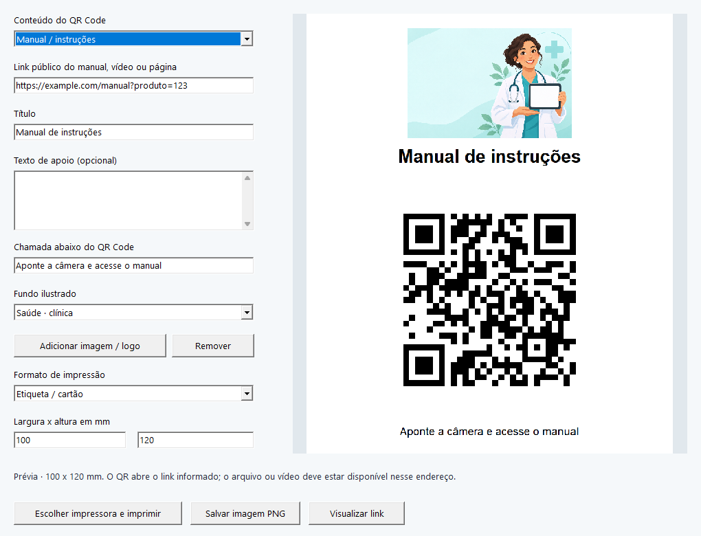
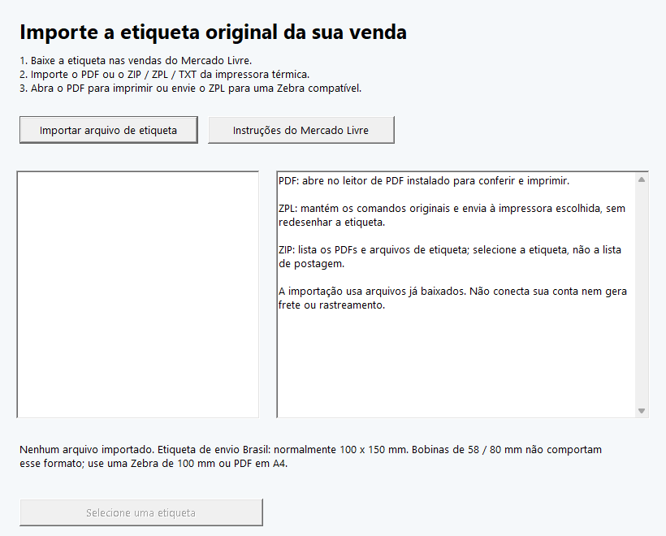

# Manual do usuário

Este manual explica como usar o **Etiquetas** no dia a dia.

O sistema foi pensado para permitir que o usuário trabalhe com etiquetas sem precisar conhecer banco de dados ou programação.

---

## 1. Tela principal

Ao abrir o sistema, escolha o tipo de impressora nos cartões ilustrados:

| Cartão | Uso |
|---|---|
| Zebra / rolo | Etiquetas adesivas em rolo. |
| Térmica 80 mm | Bobina de balcão e PDV. |
| Térmica 58 mm | Bobina compacta ou portátil. |
| Laser / jato de tinta | Folhas Pimaco A4/Carta e cartazes. |

Depois, use **Buscar modelo de etiqueta...** ou o filtro de finalidade e abra o
cartão desejado. Os modelos são abertos no modo de impressão escolhido. A tela
reorganiza os cartões quando a janela muda de tamanho.

Os cartões **Manuais e vídeos · QR Code** e **Mercado Livre · envios** oferecem
os novos fluxos descritos nas seções 9 e 10 deste manual.

Para os assistentes antigos de produtos, mala direta, laboratório e PIX, use
**Configurações → Alternar início / tela clássica**. Os procedimentos das
seções 3 a 7 descrevem esses módulos anteriores.

Os principais módulos são:

- Etiquetas de gôndola / produtos.
- Importação de dados.
- Mala direta.
- Etiquetas de laboratório.
- PIX Brasil.
- Configuração.

Use os botões ou imagens da tela para acessar cada módulo.

---

## 2. Configuração inicial

Antes de usar o sistema pela primeira vez, entre em **Configurações → Preferências**.

Confira:

1. Caminho do banco de dados.
2. Caminho da biblioteca SQLite.
3. Nome da empresa.
4. Endereço da empresa.
5. Impressora configurada no sistema operacional.

Salve as alterações.

---

## 3. Etiquetas de gôndola / produtos

Este módulo é usado para imprimir etiquetas de produtos, como etiquetas de preço, identificação ou gôndola.

### Como usar

1. Acesse o módulo de etiquetas de gôndola.
2. Abra a tela de produtos.
3. Pesquise ou localize o produto desejado.
4. Adicione o produto à lista de impressão.
5. Repita o processo para todos os produtos desejados.
6. Acesse a aba de impressão.
7. Clique em imprimir.

Após a impressão, o sistema limpa a seleção de produtos para evitar reimpressão acidental.

### Campos usados na etiqueta de produto

O sistema trabalha com os seguintes campos principais:

| Campo | Uso |
|---|---|
| Descrição do produto | Nome principal exibido na etiqueta. |
| Detalhe do produto | Informação complementar. |
| Detalhe 01 | Informação adicional. |
| Detalhe 02 | Informação adicional. |
| Preço | Valor impresso na etiqueta. |

---

## 4. Importação de produtos

Use esta opção quando já existir uma lista de produtos em CSV.

### Passos

1. Acesse **Configurações → Importar dados**.
2. Escolha **Importar Produtos**.
3. Selecione o arquivo CSV.
4. Confirme a importação.
5. Aguarde a mensagem de sucesso.

O arquivo precisa seguir o layout documentado em [Importação de CSV](importacao_csv.md).

---

## 5. Mala direta

O módulo de mala direta é usado para imprimir etiquetas de endereço.

### Como usar

1. Importe ou cadastre endereços.
2. Acesse o módulo **Mala Direta**.
3. Pesquise pelo nome desejado.
4. Selecione um ou mais destinatários.
5. Avance no assistente.
6. Visualize ou imprima a etiqueta.

### Dados usados

O sistema usa os dados da empresa configurados em **Configuração** como origem/remetente, e os dados selecionados como destinatário.

---

## 6. Etiquetas de laboratório

Este módulo serve para imprimir etiquetas simples de identificação com texto e código de barras.

### Como usar

1. Acesse **Etiqueta de Laboratório**.
2. Pesquise ou selecione um registro.
3. Adicione o registro à seleção.
4. Avance no assistente.
5. Confira o rótulo e o código de barras.
6. Imprima.

### Campos usados

| Campo | Uso |
|---|---|
| Rótulo 01 | Texto principal da etiqueta. |
| Rótulo 02 | Texto secundário. |
| Barcode | Código usado para gerar o código de barras. |

---

## 7. PIX Brasil

O módulo PIX Brasil permite gerar um QR Code a partir de uma string PIX informada.

### Como usar

1. Acesse **PIX Brasil**.
2. Cole ou digite a string PIX no campo indicado.
3. O QR Code será atualizado na tela.
4. Clique em imprimir para enviar o QR Code à impressora padrão.

Atenção: o sistema gera o QR Code com base no texto informado. A validade bancária do payload PIX deve ser conferida pelo usuário ou pelo sistema que gerou a string.

---

## 8. Seleção e impressão

Em vários módulos, o sistema usa o conceito de seleção:

1. Existe uma lista principal com todos os registros.
2. O usuário escolhe os registros que quer imprimir.
3. Os registros escolhidos vão para uma lista de impressão.
4. A impressão usa apenas a lista selecionada.

Essa lógica evita imprimir toda a base por engano.

---

## 9. Manuais, vídeos e orientações em QR Code

1. Escolha a impressora no painel e abra **Manuais e vídeos · QR Code**.
2. Selecione manual, vídeo, orientações de saúde ou divulgação.
3. Cole o link completo do conteúdo, começando com `https://` ou `http://`.
4. Personalize o título, o texto de apoio opcional e a chamada abaixo do QR.
5. Escolha um fundo: **Saúde · clínica**, **Saúde · laboratório**,
   **Varejo · supermercado** ou **Varejo · loja e entregas**.
6. Use **Adicionar imagem / logo** para incluir sua imagem. Com um fundo
   selecionado, ela ocupa a área livre da ilustração. **Remover** retira a
   imagem adicionada; **Sem fundo ilustrado** retira o fundo.
7. Confira a prévia e as dimensões. No modo laser/jato, também há **Cartaz A4**.
8. Use **Visualizar link** para conferir o destino, **Salvar imagem PNG** para
   exportar ou **Escolher impressora e imprimir** para imprimir.

O conteúdo precisa estar disponível no endereço informado: o sistema grava o
link no QR Code, sem hospedar o manual ou o vídeo. Trocar a finalidade altera
o título e a chamada sugeridos; personalize esses campos depois da escolha.

Links inválidos, textos que não cabem e QR Codes densos demais para a dimensão
selecionada bloqueiam a impressão/exportação até serem corrigidos. Reduza o
texto, use um link menor, aumente a altura ou retire a imagem conforme a mensagem.

O cartão QR em folha é individual, sem grade Pimaco. As grades continuam
disponíveis nos demais modelos de folha. Consulte os limites de largura em
[Configuração de impressora](configuracao_impressora.md).

## 10. Importar etiquetas de envio do Mercado Livre

1. Baixe a etiqueta original da venda no Mercado Livre.
2. Abra **Mercado Livre · envios → Importar arquivo de etiqueta**.
3. Selecione PDF, ZIP, ZPL, TXT ou PRN. Os arquivos individuais têm limite de 32 MB.
4. Para ZIP, escolha o arquivo correto na lista: o PDF de resumo/PLP pode ser
   um documento diferente da etiqueta de envio.
5. Para PDF, use **Abrir PDF para conferir e imprimir**. O leitor instalado
   abre o arquivo; nele, confira as páginas, escolha a impressora e mantenha o
   tamanho original e o papel correspondente.
6. Para ZPL/TXT/PRN com comandos ZPL, selecione **Zebra / rolo** no início e use
   **Enviar ZPL à impressora Zebra**. Esse envio direto está disponível no Windows.

O aplicativo preserva a etiqueta original. Não cria rastreamento, não gera
frete e não conecta automaticamente sua conta. TXT e PRN precisam conter ZPL;
um arquivo de texto comum não é uma etiqueta compatível.

O formato brasileiro padrão de envio é 100 × 150 mm. Ele exige uma impressora
com largura adequada ou o PDF no papel correspondente; não cabe em bobinas de
58/80 mm. Não há prévia visual integrada de PDF ou ZPL: use a versão PDF no
leitor instalado para conferir a aparência.

Veja as [instruções e fontes oficiais](NOVO_INICIO.md#etiquetas-de-envio-do-mercado-livre).

## 11. Cuidados importantes

- Faça backup do banco `etiqueta.db`.
- Teste a impressão com poucas etiquetas antes de imprimir em lote.
- Confira se a impressora correta está selecionada no sistema operacional.
- Verifique se o CSV possui o número correto de colunas.
- Não apague arquivos da pasta `db` ou `sqlite` sem orientação técnica.

---

## 12. Quando chamar suporte técnico

Procure apoio técnico quando:

- O sistema não abrir.
- O banco de dados não for localizado.
- A biblioteca SQLite estiver ausente.
- A impressora não responder.
- A etiqueta sair fora do tamanho esperado.
- A importação CSV falhar mesmo com layout correto.
